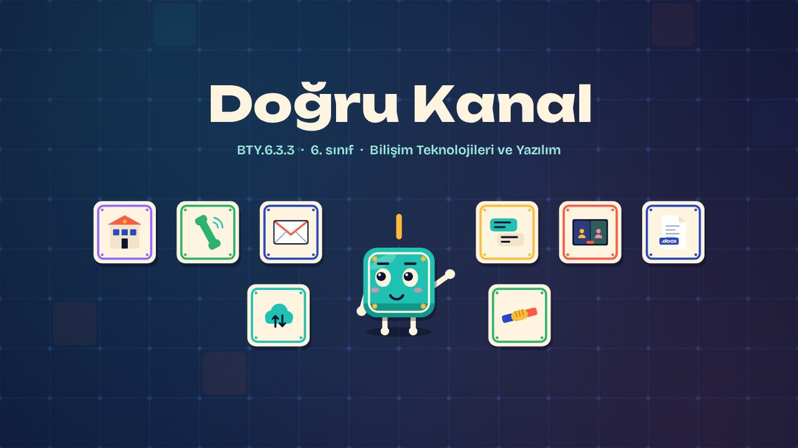
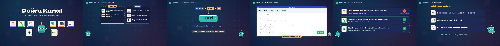

# Doğru Kanal · The Right Channel

**▶ Tarayıcıda izleyin / Watch in the browser:** https://hakanatas.github.io/dogru-kanal/ 
**⬇ MP4 + altyazılar / MP4 + subtitles:** [Releases](https://github.com/hakanatas/dogru-kanal/releases) 
**✎ Kullanılan istem / The prompt behind it:** [PROMPT.md](PROMPT.md) 
**🎞 Bütün filmler / All films:** [Bilişim Filmleri](https://hakanatas.github.io/bilisim-filmleri/?sinif=6)

> **TR —** 6. sınıf Bilişim Teknolojileri ve Yazılım dersinin "Bilgisayar Ağları ve İletişim" temasındaki BTY.6.3.3 öğrenme çıktısı için hazırlanmış, tamamen JavaScript ile çizilen 2,3 dakikalık animasyon; ses efektleri ve hafif fon müziği de kodla üretilir. Günlük ve resmî durumlar için uygun iletişim teknolojisi seçilir: arkadaşlara anlık mesaj, öğretmene e-posta, acil durumda telefon. Bir e-postanın parçaları (adres, konu, ileti, ek) ve resmî yazışma kuralları tanıtılır. Öğretmene ödev göndermek için e-posta hazırlanır: alıcı, konu, saygılı bir ileti ve ek dosya eklenip gönderilir. Son olarak iletişim araçlarının kullanımı amaca uygunluk açısından değerlendirilir. Altyazılar Türkçe, İngilizce ya da ikisi birlikte seçilebilir.

A 2.3-minute animation, with code-generated sound, for **6th-grade IT and Software** (Türkiye Yüzyılı Maarif Modeli). Karo picks suitable tools for everyday and formal situations, learns the parts of an email and formal-writing rules, sends his homework to his teacher by email with a subject, a polite message and an attachment, and judges tool choices for purpose. The guide is **Karo**, a living glazed tile who never speaks: he tells the story with his face, his arms and the blinking cursor above his head.

## Öğrenme çıktısı · Learning outcome

MEB, Türkiye Yüzyılı Maarif Modeli, Bilişim Teknolojileri ve Yazılım Dersi Öğretim Programı, 6. sınıf, 3. tema "Bilgisayar Ağları ve İletişim":

**BTY.6.3.3. İletişim teknolojileri ile çalışabilme**
- a) Farklı ve eş zamanlı olarak kullanılan iletişim teknolojilerini amacına uygun olarak belirler.
- b) Bir e-posta aracını amacına uygun olarak kullanır.
- c) İletişim araçlarını kullanım amaçlarına uygunluğu açısından değerlendirir.

## Sahneler · Scenes

| # | Zaman | Sahne | Ne oluyor | Çıktı |
|---|---|---|---|---|
| 1 | 0:00–0:16 | Giriş |  |  |
| 2 | 0:16–0:39 | Günlük mü, resmî mi? | İletişim teknolojilerini amaca uygun belirlemek. | a |
| 3 | 0:39–1:08 | E-postanın parçaları | Adres, konu, ileti ve ek; resmî yazışma kuralları. | b |
| 4 | 1:08–1:37 | E-postayı gönder | Alıcı, konu, ileti ve ek dosya ile e-posta göndermek. | b |
| 5 | 1:37–1:60 | Amaca uygun mu? | İletişim araçlarının kullanımı amaca uygunluk açısından değerlendirilir. | c |
| 6 | 1:60–2:15 | Aklında kalsın |  |  |

## Çalıştırma · Running it

- **Önizleme:** `index.html` dosyasına çift tıklayın (çevrim dışı da çalışır). Klavye: boşluk oynat/duraklat, ← → 3 sn, Home başa. Adrese `?altyazi=en`, `?bicim=vertical` ya da `?ses=0` eklenebilir.
- **MP4:** bir kez `npm install`, sonra `npm run export -- --format=both --captions=tr` (720p yatay ve dikey, sesli). Google Chrome yüklüyse Playwright onu kullanır (`channel: 'chrome'`); ffmpeg gerekir.
- **Altyazı ve seslendirme notları:** `npm run srt` → `out/dogru-kanal_tr.srt`, `_en.srt`, `_tr-en.srt`, `_seslendirme-notlari.txt`.
- **Sürüm dosyaları:** `npm run release` → `release/` klasöründe v1.0'ın 6 dosyası.
- **Yazı kontrolü:** `npm run check` yatay ve dikey düzende, üç altyazı seçeneğiyle üst üste binen, kenardan taşan ya da 720p'de 17 pikselden küçük kalan yazı arar.
- **Düzenleme:** senaryo (sahneler, altyazılar, seslendirme notları) `scenes/film.js` içindedir; değiştirince `npm run build` süreleri, `captions.js` ve `film.config.js` dosyalarını yeniden üretir. Sahne şablonları `src/kit/`, Karo `src/draw/karo.js`, ses `src/audio/synth.js`.

Her kare `renderFrame(t)` ile zamanın saf fonksiyonu olarak çizilir; rastgelelik tohumludur, MP4 ekran kaydı değil kare kare üretimdir. Ses de dosyadan çalınmaz: aynı olay listesinden hesaplanır. Yazı tipleri: Unbounded ve Bricolage Grotesque (SIL OFL 1.1), dosyaya gömülü.

## Lisans · License

**TR —** Bu film ve kodu [Creative Commons Atıf-GayriTicari 4.0 Uluslararası (CC BY-NC 4.0)](https://creativecommons.org/licenses/by-nc/4.0/deed.tr) lisansıyla paylaşılır. Ticari olmayan her amaçla (derste, okulda, eğitim materyalinde) kopyalayabilir, paylaşabilir ve değiştirebilirsiniz; ancak **kaynak göstermek zorunludur**: eser sahibinin adı ve bu deponun bağlantısı belirtilmeden kullanılamaz. Ticari kullanım (satış, ücretli ürün ya da yayın) için izin alınmalıdır.

**EN —** This film and its code are licensed under [Creative Commons Attribution-NonCommercial 4.0 International (CC BY-NC 4.0)](https://creativecommons.org/licenses/by-nc/4.0/). You may copy, share and adapt them for non-commercial purposes, but **attribution is required**: they may not be used without crediting the author and linking to this repository. Commercial use requires permission.

Atıf örneği / Required credit: *“Doğru Kanal”, Hakan Ataş, Bilişim Filmleri — https://github.com/hakanatas/dogru-kanal — CC BY-NC 4.0*
